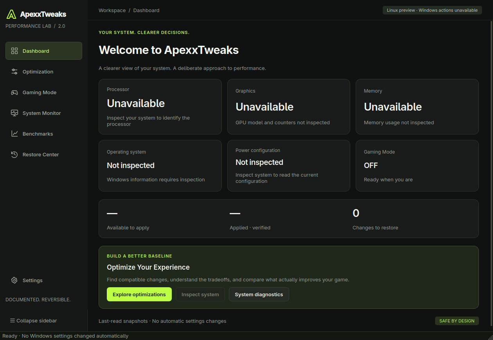

# ApexxTweaks 2.0

Windows 10/11 gaming diagnostics and reversible optimization, developed on Bazzite Linux. A completely redesigned PySide6 Widgets desktop UI with a collapsible sidebar, near-black surfaces and electric lime accents. No embedded browser, telemetry, resident service or kernel driver. No measured FPS improvement or universal anti-cheat approval is claimed.

## The 2.0 workspace



The screenshot is a real Linux Qt preview with uninspected hardware, not fabricated Windows readings. [More screenshots and design notes](docs/UI_2.md).

| Page | What it does |
|---|---|
| Dashboard | Hardware and last-read usage cards, current power plan, Gaming Mode status, verified action counts and direct recovery/diagnostic access |
| Optimization | Searchable action cards, categories, recommendations, risk/admin/backup indicators, applied-only filter, sorting, compatibility checks, individual Apply/Restore and guided Windows Settings |
| Gaming Mode | Explicit session selections, Balanced/Competitive/Custom suggestions, Fortnite detection/guidance, optional exit watching and emergency session restore |
| System Monitor | Opt-in CPU, peak 3D engine and RAM charts, bounded sustained sampling, hardware/driver/storage/network details and read-only process activity |
| Benchmarks | Independent CSV imports, FPS/lows/p99, distribution and bucket-peak trace plots, before/after bars and intervals, archives and exports |
| Restore Center | Original values, timestamps, backup/history details, conflict inspection, individual restore, Restore All and optional Windows restore-point request |
| Settings | Reduce motion, start minimized, startup page, monitor interval, local logs/diagnostic export, version, licenses and repository |

The UI is a new presentation layer over the existing backend. Action IDs, typed snapshots, legacy folders, optional-task namespaces, scoped Gaming Mode rollback and anti-cheat boundaries remain unchanged. Human-readable descriptions are shown on demand; raw diagnostic/journal details remain available through explicit detail buttons.

Long operations run through one serialized Qt worker with main-thread result signals. There is no idle polling timer. Monitoring runs only when explicitly enabled, System Monitor is visible and the window is not minimized; game watching runs only for an explicitly armed active session. Finite page/sidebar transitions can be disabled. Qt Widgets/Gui/Svg are used; no QML, WebEngine, QtCharts, external icon/font service or animation loop.

## Actions and scope

| Action family | What changes | When it may help | Restore |
|---|---|---|---|
| High performance plan | Select existing Windows plan on AC | Hardware-dependent ramp behavior; can regress with heat | Original GUID, plus exported plan backup |
| Best performance AC mode | Supported Windows 11 user-configured AC mode | Compatible devices using Balanced base plan; effective mode can be overridden | Exact original mode GUID |
| Recording policy | Windows 10 AllowGameDVR=0 | When Windows game recording was using resources | Original DWORD or absence |
| Optional startup | Remove one exact current-user Run value | Avoid future optional-app launches after sign-in | Exact command/type; refuse changed entry or unsigned replacement |
| Optional task | Disable selected app-launch task under `\ApexxTweaksOptional\` | Prevent selected launch automation during play | Original enabled state; verify XML fingerprint |
| Optional app EcoQoS | Change execution-speed QoS bit only | Reduce interference/energy from an approved background app on suitable CPUs | Original flags, bound to PID and creation time |
| Fax startup | Disable stopped, dependency-free optional Fax service | Avoid optional startup; normally no measurable FPS benefit | Exact startup mode |

EcoQoS is **not a CPU usage cap** and may slow or stutter voice/music. Only the chosen instances are changed; child/new instances are not automatically enrolled. Signed image, current-user token, full path and creation time are checked; exited/reused PIDs are never written during restore. No browsers, launchers, updaters, games, anti-cheat or security processes qualify. Common Discord updater-based startup commands intentionally remain read-only.

Task changes require explicit opt-in into `\ApexxTweaksOptional\`, current-user SID, non-elevated principal, a single direct Spotify/Discord launch and approved arguments/signature. This is not permission to disable arbitrary third-party tasks. Update/security/system tasks remain untouched. Running tasks are never stopped. See [task opt-in instructions](docs/USAGE.md).

**Game Mode, Windows 11 recording and GPU preferences:** buttons open supported Windows Settings pages, with state/guidance where available. These remain user-driven and are outside the rollback journal. No undocumented UserGpuPreferences, HAGS or recording registry writes. The documented Game Mode registry location is read for status, not treated as a public write contract.

## Run or build on Windows

For source development: official CPython 3.13 x64 and the pinned PySide6 Essentials dependency; Windows 10 build 19041+ or Windows 11 desktop, Windows PowerShell 5.1/CIM. Prefer a currently supported Windows release. Optional providers, policy restrictions or unsupported APIs produce errors, not fabricated readings.

```powershell
python -m pip install -e .
python -m unittest discover -s tests -v
python -m tweaker
```

Start as a normal user. Explicitly restart elevated only when choosing the Fax or recording-policy action or a restore point; never silently elevate. UI confirmation is required before applying. Domain/enrollment-managed devices are excluded from recording-policy writes; conservative enrollment checks may also refuse some personal devices.

Build/download instructions: [Standalone Windows x64 executable](docs/WINDOWS_BUILD.md).

GitHub Actions builds a complete PyInstaller portable directory, creates **ApexxTweaks-windows-x64.zip**, smoke-tests that exact ZIP without Python on PATH, and uploads it as **ApexxTweaks-windows-x64** only after successful testing. Download it from a successful **Actions → ApexxTweaks Windows x64 portable build** run, extract the artifact, then extract the inner ZIP and launch **ApexxTweaks/ApexxTweaks.exe**. Keep the entire folder, including `_internal`. **No Python installation is required for end users.**

For local packaging, install CPython 3.13 x64 and PowerShell 7, then run:

```powershell
python -m pip install -r requirements-build.txt .
pwsh -File scripts/build-windows.ps1
pwsh -File scripts/smoke-windows.ps1
```

No installer or signing certificate is included. PyInstaller cannot cross-compile Windows from Linux. This workspace has not executed the Windows Actions workflow: packaged Windows startup and Windows 11 functionality remain unverified. The workflow uses a Windows Server hosted runner; even a passing smoke test still needs Windows 11 desktop validation.

## Bazzite development

Use a managed CPython 3.13 virtual environment. The host Python may be newer than the pinned Qt wheels support. The backend still uses only the standard library; the frontend requires Qt.

```bash
uv venv --python 3.13
uv pip install --python .venv/bin/python -e .
.venv/bin/python -m tweaker
QT_QPA_PLATFORM=offscreen .venv/bin/python -m unittest discover -s tests -v
QT_QPA_PLATFORM=offscreen .venv/bin/python launcher.py --smoke-test
```

`uv` is a developer tool, not an end-user runtime requirement. Alternatively create a Python 3.13 venv and `python -m pip install -e .`. If the desktop Qt platform plugin lacks native X11/Wayland libraries, use a development distrobox with the corresponding native dependencies; avoid layering Python GUI packages onto the immutable host. `QT_QPA_PLATFORM=offscreen` supports automated widget rendering and tests without desktop integration. It does not validate Windows or Linux window-manager behavior.

Linux previews every page and analyzes imported captures; Windows mutations remain refused. Native Windows registry/QoS tests skip on Linux. GUI tests require the declared project dependencies and use Qt's offscreen platform. See [UI architecture and keyboard controls](docs/UI_2.md).

## Safe workflow

1. Inspect hardware and sustained activity. Review optional startup/task inventories; names alone never prove something is unnecessary.
2. In Optimization, inspect compatibility, discover approved apps, search/filter and read each action. Balanced selects nothing. Competitive proposes the Windows 11 AC-mode experiment; optional apps require individual selection. Windows 10 users can select the classic plan manually. Optional restore points are offered in Restore Center; snapshots are mandatory regardless.
3. Apply one persistent change, or use Gaming Mode, choose eligible session actions and turn the mode switch on. Persistent-only selections are excluded from Gaming Mode and never silently applied.
4. Capture repeated matched external frame-time runs with identical monitoring, route, warm-up, graphics, cap and thermal conditions. No capture tool is installed/launched, and no protected game handles are opened.
5. Import ≥3 independent CSVs per condition under the same experiment context. Compare average, lows, p99, variation and graphs; regressions matter too.
6. Undo a selected action or restore all. Persistent changes are individually confirmed, or explicitly selected under Select multiple and reviewed as a per-action batch; Gaming Mode startup has scoped rollback. Conflicts/errors remain in History for recovery. If the watcher fails, it explicitly disarms and leaves restoration to the user.

Backups/logs/history: `%LOCALAPPDATA%\ApexxTweaks`; Linux preview: `~/.local/share/ApexxTweaks`. Existing installations automatically reuse their populated legacy data folder in place; see [upgrade and rollback compatibility](docs/UPGRADING.md). No snapshots or journal targets are renamed. The 0.1 history format remains readable; new records add action descriptions and session ownership. Preserve snapshot folders and `history.json` until every change is restored. A corrupt journal must be repaired from backups before further writes. App exports can contain usernames, paths, process information and task definitions; review before sharing.

Restore refuses external-setting conflicts. QoS restore of a vanished original process is recorded as restored-by-lifetime. Missing executables/signature failures or changed task definitions can block restore: inspect the stored snapshot and restore manually through the owning application's settings, Task Scheduler or Services. Original plan backup can be imported with `powercfg /import` if needed; inspect the new GUID before activating it. No blanket force mode is exposed.

## Measurement details and remaining limitations

CSV requires `frametime_ms`, `MsBetweenPresents` or `FrameTime`, in milliseconds, ≥1000 finite positive frames, one process/swapchain. Multiple Application/ProcessID/SwapChainAddress streams are rejected. Duplicate file content is rejected by the UI; renaming a capture is not an independent repeat. Context strings are user-supplied, so matching is still the user's responsibility. New experiment archives previous runs. Legacy 0.1 runs without context can be viewed/exported but must be recaptured with context for the advanced comparison.

FPS = 1000/mean frame time. Lows use the mean of the slowest ceil(1%/0.1%) frames; p99 nearest rank. Intervals resample independent **runs**, not individual autocorrelated frames. Exploratory percentile bootstrap intervals can be unreliable with small samples and do not prove causality. Short/mismatched-duration captures generate warnings. Presentation/frame-generation semantics must match; no capture semantics are inferred from a CSV name. No input-latency metric is fabricated. Newly imported results also preserve a maximum-of-bucket frame-time trace (up to 300 points), explicitly labeled as downsampled peaks. Legacy results without trace metadata remain readable.

Still absent: thermal/VRAM instrumentation, causal game-thread profiling, continuous trace correlation, end-to-end input latency, per-process network bandwidth, game packet-loss measurement, SMART detail and automated in-game graphics writes. Read-only counters may be absent. GPU engine maxima are screening signals, not aggregate whole-GPU utilization. No memory cleaners, timer/HPET hacks, TCP registry tweaks, security reductions, priority/affinity changes, process suspension, injection, game-file modification or kernel components.

Windows configuration changes, real-game performance and anti-cheat behavior remain **unverified on Windows in this workspace**. Compatibility is an engineering constraint, not a certification claim. See [rationale](docs/OPTIMIZATIONS.md), [usage](docs/USAGE.md), [architecture](docs/ARCHITECTURE.md) and [validation](docs/VALIDATION.md).
